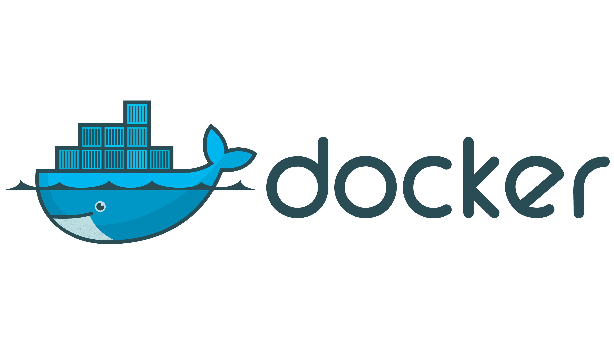
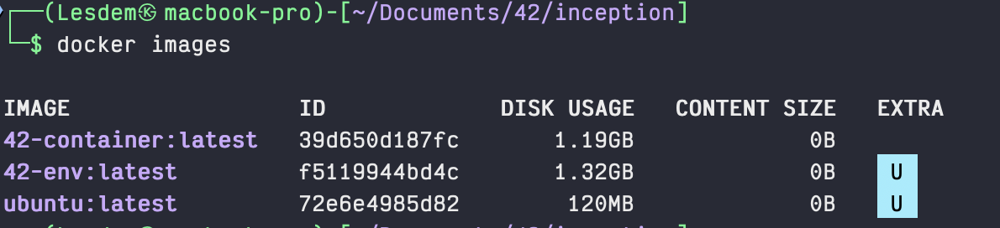
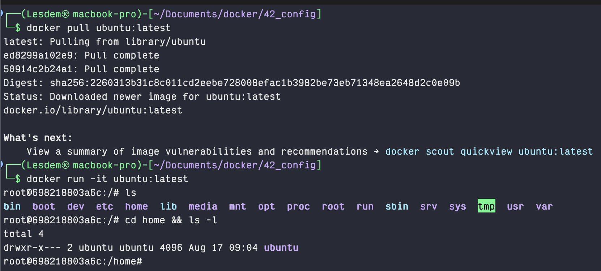
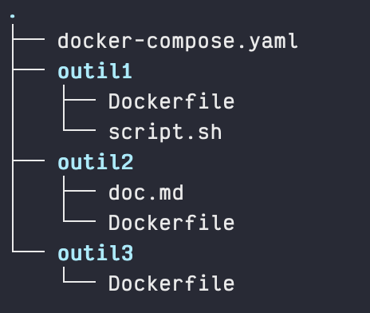
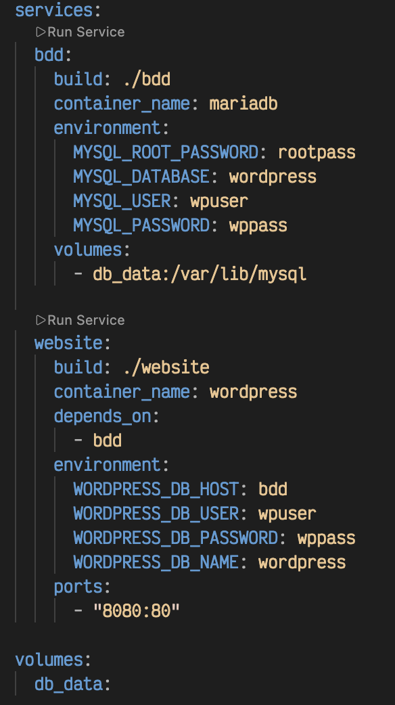
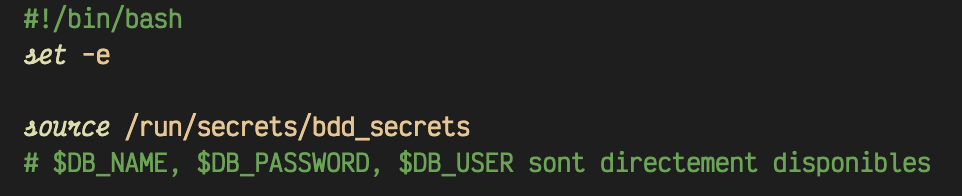

# INCEPTION
*Où comment travailler avec des containers ??*

## Containers ?? c'est quoi ça ??

En début de tronc commun, nous avons appris à créer de toute piece une machine virtuelle avec une interface assez minimaliste car - pour souvenir - nous n'avions qu'un terminal. Mais de manière plus générale lorsque l'on construit une machine virtuelle c'est que nous voulons bénéficier, à l'intérieur d'un environnement déjà existant (Windows ou autre par exemple), d'un autre environnement complet pour diverses raisons (un linux pour coder sans avoir envie d'avoir un dualboot sur sa machine par exemple).

Qui dit environnement complet dit allocations de mémoire (disque dur), de ressources (coeurs processeurs, ram voir mémoire graphique) et donc dit qu'il faut potentiellement faire des choix de performances surtout lorsque notre configuration de base est pas extraordinaire.

Pour certains ... cette solution est trop lourde surtout que souvent les besoins ne justifient pas toute cette usine à gaz.

C'est LÀ que les containers entrent en jeu. Et qui dit container dit ... DOCKER !!!

## Docker



### Un peu d'histoire ? 

A la base Docker c'est un projet interne de la société française dotCloud, elle est développée pour mettre en place un systeme de containerisation de différents produits/applications dans des environnement minimaliste afin d'être plus facile de gestion, d'entretien, d'évolution.

Ca marche plutot bien, plutot tres bien meme puisque ca devient open source en 2013.

### Et comment ça marche ? 

En fait la grosse particularité de Docker et qui en fait sa force c'est que nous ne travaillons pas dans un nouveau systeme d'exploitation en parallele ou en surplomb d'un OS deja existant. En fait Docker fonctionne via le systeme d'exploitation en place initialement (Linux), ou en générant lui-même une "VM simplifiée" et invisible pour l'utilisateur afin de fonctionner (Windows, MacOs) et propose un accès à une interface minimaliste (le plus souvent un terminal) sous un environnement précis (par exemple ubuntu, debian, fedora ou autre). On peut donc travailler dans un shell UNIX comme si on était sur une distribution linux ... mais depuis une machine qui fonctionne sur tout autre chose.

Ca peut meme aller plus loin, on peut "virtualiser des fichiers/dossiers que l'on a sur notre machine locale, à l'intérieur du container en marche, afin de travailler dessus avec des outils qui ne seraient par exemple pas dispo sur la machine en local.

Un exemple très simple, le mien ... Je bosse sur MacOS, cette distribution (ou plutot cet OS) repose sur un noyau UNIX mais est pimpé par nos amis de la pomme de telle sorte que des outils utiles pour les projets de 42 ne sont pas dispo/compatibles. Un exemple concret est Valgrind.

Du coup lorsque je bosse sur mon Mac, j'utilise un Docker (un container) que j'ai configuré pour fonctionner sous une version lite de ubuntu, dans lequel j'ai installé les mêmes versions de clang, valgrind et autres afin d'avoir une config "ISO" 42.

Donc pour répondre à la question et pour faire court ... on doit configurer un container avec la config que l'on veut pour pouvoir effectuer la tache que l'on souhaite. Cette tâche est souvent précise. Si on voulait pouvoir faire tout et n'importe quoi, alors Docker ne serait pas une bonne solution.

Mais Docker c'est pas forcément un environnement de type "OS simplifié" !! C'est potentiellement un sgbd (systeme de gestion de base de données comme mysql ou oracle), un langage (à un certain moment j'ai bossé dans un container Python sous une version particuliere, la 3.9.2 de mémoire, afin d'y executer un shell python et d'executer du code python qui devait fonctionner sous cette version absolument), un outil de CI/CD ... bref ça peut etre vraiment plein de choses !!!!

## Revenons à nos containers !!

En fait pour pouvoir créer un container ... il faut lui donner une configuration et permettre à Docker de valider celle-ci. Ce n'est qu'après cette étape que l'on peut créer un ou plusieurs containers avec cette configuration. 

Petite precision ! c'est quoi un container ?? un container c'est un environnement isolé et léger qui partage le noyau de la machine hôte, contrairement à une VM qui embarque son propre noyau

Cette étape de configuration permet d'obtenir une chose -> une image Docker.

### L'image Docker !!! 

Une image Docker est générée à partir d'un fichier Dockerfile, ce fichier possède une syntaxe particuliere faites de mot clés.

*Un exemple simple d'un Dockerfile* 
```docker
FROM ubuntu:latest

RUN apt-get update && apt-get install -y \
    curl \
    vim \
    && rm -rf /var/lib/apt/lists/*

WORKDIR /app

CMD ["/bin/bash"]
```
Dans cet exemple on peut voir plusieurs mot clés spécifiques à Docker (FROM, RUN, WORKDIR et CMD), chacuns d'eux ont une signification et seront détaillés plus loin. Il existe une excellente doc pour comprendre tous ces mot clés et est dispo [ici](https://docs.docker.com/reference/dockerfile/)

*Typiquement ici qu'est ce que l'on fait ?*

```docker
FROM ubuntu:latest ---> Je veux utiliser la derniere version de ubuntu

RUN apt-get update && apt-get install -y \---> Au démarrage il faudra update les mises à jour. Ensuite on va installer ...
    curl \                                ---> curl
    vim \                                 ---> et vim
    && rm -rf /var/lib/apt/lists/*        ---> pour finir on supprime les données dans ce dossier

WORKDIR /app  -------> Notre répertoire de travail sera /app, on verra ce que cela signifie plus tard

CMD ["/bin/bash"] -----> Quand on démarre le container on fait cette commande pour bosser dans un bash
```
Les Dockerfile ont TOUJOURS cette syntaxe et cette forme, là c'est quelque chose de plutôt simple !! mais pour certains besoins très complexes et spécifiques, un Dockerfile peut faire plusieurs dizaines voir centaines de lignes.

Une fois ce fichier realise, nous allons devoir demander à Docker de l'executer afin de construire une image. Cette image va etre stockée en local sur votre machine et servira de support pour créer des containers. C'est cette image qui devra etre mise à jour, modifiée afin de faire évoluer votre configuration. Les containers ne seront quant à eux pas mis à jour, il faudra en créer de nouveaux.

Docker met à disposition une jolie panoplie de commandes afin de pouvoir faire ce que nous voulons 

*ce que Docker me donne comme possibilités* 
```
┌──(Lesdem㉿macbook-pro)-[~/Documents/docker/42_config]
└─$ docker
Usage:  docker [OPTIONS] COMMAND

A self-sufficient runtime for containers

Common Commands:
  run         Create and run a new container from an image
  exec        Execute a command in a running container
  ps          List containers
  build       Build an image from a Dockerfile
  bake        Build from a file
  pull        Download an image from a registry
  push        Upload an image to a registry
  images      List images
  login       Authenticate to a registry
  logout      Log out from a registry
  search      Search Docker Hub for images
  version     Show the Docker version information
  info        Display system-wide information

Management Commands:
  agent*      Docker AI Agent Runner
  ai*         Docker AI Agent - Ask Gordon
  builder     Manage builds
  buildx*     Docker Buildx
  compose*    Docker Compose
  container   Manage containers
  context     Manage contexts
  debug*      Get a shell into any image or container
  desktop*    Docker Desktop commands
  dhi*        CLI for managing Docker Hardened Images
  extension*  Manages Docker extensions
  image       Manage images
  init*       Creates Docker-related starter files for your project
  manifest    Manage Docker image manifests and manifest lists
  mcp*        Docker MCP Plugin
  model*      Docker Model Runner
  network     Manage networks
  offload*    Docker Offload
  pass*       Docker Pass Secrets Manager Plugin (beta)
  plugin      Manage plugins
  scout*      Docker Scout
  system      Manage Docker
  volume      Manage volumes

Swarm Commands:
  swarm       Manage Swarm

Commands:
  attach      Attach local standard input, output, and error streams to a running container
  commit      Create a new image from a container's changes
  cp          Copy files/folders between a container and the local filesystem
  create      Create a new container
  diff        Inspect changes to files or directories on a container's filesystem
  events      Get real time events from the server
  export      Export a container's filesystem as a tar archive
  history     Show the history of an image
  import      Import the contents from a tarball to create a filesystem image
  inspect     Return low-level information on Docker objects
  kill        Kill one or more running containers
  load        Load an image from a tar archive or STDIN
  logs        Fetch the logs of a container
  pause       Pause all processes within one or more containers
  port        List port mappings or a specific mapping for the container
  rename      Rename a container
  restart     Restart one or more containers
  rm          Remove one or more containers
  rmi         Remove one or more images
  save        Save one or more images to a tar archive (streamed to STDOUT by default)
  start       Start one or more stopped containers
  stats       Display a live stream of container(s) resource usage statistics
  stop        Stop one or more running containers
  tag         Create a tag TARGET_IMAGE that refers to SOURCE_IMAGE
  top         Display the running processes of a container
  unpause     Unpause all processes within one or more containers
  update      Update configuration of one or more containers
  wait        Block until one or more containers stop, then print their exit codes

Global Options:
      --config string      Location of client config files (default "/Users/Lesdem/.docker")
  -c, --context string     Name of the context to use to connect to the daemon (overrides DOCKER_HOST env var and default context set with "docker context use")
  -D, --debug              Enable debug mode
  -H, --host string        Daemon socket to connect to
  -l, --log-level string   Set the logging level ("debug", "info", "warn", "error", "fatal") (default "info")
      --tls                Use TLS; implied by --tlsverify
      --tlscacert string   Trust certs signed only by this CA (default "/Users/Lesdem/.docker/ca.pem")
      --tlscert string     Path to TLS certificate file (default "/Users/Lesdem/.docker/cert.pem")
      --tlskey string      Path to TLS key file (default "/Users/Lesdem/.docker/key.pem")
      --tlsverify          Use TLS and verify the remote
  -v, --version            Print version information and quit

Run 'docker COMMAND --help' for more information on a command.

For more help on how to use Docker, head to https://docs.docker.com/go/guides/
```

Ici pour pouvoir créer notre image nous devrons faire 
```
docker build -t <nom de l'image> .
```
Pour connaitre les options propres à une commande spécifique il suffit de rajouter l'option --help, par exemple
```
┌──(Lesdem㉿macbook-pro)-[~/Documents/docker/42_config]
└─$ docker build --help
Usage:  docker buildx build [OPTIONS] PATH | URL | -

Start a build

Aliases:
  docker build, docker builder build, docker image build, docker buildx b

Options:
      --add-host strings              Add a custom host-to-IP mapping (format: "host:ip")
      --allow stringArray             Allow extra privileged entitlement (e.g., "network.host", "security.insecure", "device", "buildx.local.delete")
      --annotation stringArray        Add annotation to the image
      --attest stringArray            Attestation parameters (format: "type=sbom,generator=image")
      --build-arg stringArray         Set build-time variables
      --build-context stringArray     Additional build contexts (e.g., name=path)
      --builder string                Override the configured builder instance (default "desktop-linux")
      --cache-from stringArray        External cache sources (e.g., "user/app:cache", "type=local,src=path/to/dir")
      --cache-to stringArray          Cache export destinations (e.g., "user/app:cache", "type=local,dest=path/to/dir")
      --call string                   Set method for evaluating build ("check", "outline", "targets") (default "build")
      --cgroup-parent string          Set the parent cgroup for the "RUN" instructions during build
      --check                         Shorthand for "--call=check"
  -D, --debug                         Enable debug logging
  -f, --file string                   Name of the Dockerfile (default: "PATH/Dockerfile")
      --iidfile string                Write the image ID to a file
      --label stringArray             Set metadata for an image
      --load                          Shorthand for "--output=type=docker"
      --metadata-file string          Write build result metadata to a file
      --network string                Set the networking mode for the "RUN" instructions during build (default "default")
      --no-cache                      Do not use cache when building the image
      --no-cache-filter stringArray   Do not cache specified stages
  -o, --output stringArray            Output destination (format: "type=local,dest=path")
      --platform stringArray          Set target platform for build
      --policy stringArray            Policy configuration (format: "filename=path[,filename=path][,reset=true|false][,disabled=true|false][,strict=true|false][,log-level=level]")
      --progress string               Set type of progress output ("auto", "none",  "plain", "quiet", "rawjson", "tty"). Use plain to show container output (default "auto")
      --provenance string             Shorthand for "--attest=type=provenance"
      --pull                          Always attempt to pull all referenced images
      --push                          Shorthand for "--output=type=registry,unpack=false"
  -q, --quiet                         Suppress the build output and print image ID on success
      --resource stringArray          Resource limits for build containers (format: "memory=2g", "cpu-quota=50000")
      --sbom string                   Shorthand for "--attest=type=sbom"
      --secret stringArray            Secret to expose to the build (format: "id=mysecret[,src=/local/secret]")
      --shm-size bytes                Shared memory size for build containers
      --ssh stringArray               SSH agent socket or keys to expose to the build (format: "default|<id>[=<socket>|<key>[,<key>]]")
  -t, --tag stringArray               Image identifier (format: "[registry/]repository[:tag]")
      --target string                 Set the target build stage to build
      --ulimit ulimit                 Ulimit options (default [])
```

A partir de là, Docker va lire le Dockerfile, télécharger les images nécessaires (ici ubuntu:latest) et lui appliquer les commandes et ordres précisés dans le ficher de configuration.

Si tout ce passe bien -> FELICITATION VOUS AVEZ CREE UNE IMAGE DOCKER

Si on veut voir nos images il suffit de faire 

```
docker images
```
On voit bien que mon image ubuntu:latest existe localement et qu'elle est en court d'utilisation actuellement (le petit U bleu)

Comme dit précedemment, cette image est stockée localement, mais il est possible de la publiée sur Docker Hub. Je n'aborde pas cette partie car ce n'est pas le but ici, mais si jamais voici le [lien](https://hub.docker.com/) vers le site en question. Pour information en 2026 Docker Hub c'est 14 millions d'images dispo et environ 11 milliards de téléchargement ... par mois (source Wikipedia).

Ce qu'il faut bien comprendre, c'est qu'il n'est pas "smart" de créer une image Docker pour un systeme complet !! une image Docker doit répondre à un besoin précis, une distrib linux précise pour telle chose, un sgbd pour bosser sur mySQL sans avoir besoin de tout installer localement etc.

Si on veut un systeme complet avec une chouette interface graphique, alors il faut opter pour une VM voir un dual boot.

### L'image est là !! et maintenant ?? 

Et bien maintenant que nous avons notre superbe image, il ne manque plus qu'à créer un container.

Comme dit précédemment il existe déjà plusieurs millions d'images disponible à l'utilisation. Par exemple à tout moment vous pouvez taper dans votre terminal 

```
docker pull ubuntu:latest --> pour telecharger l'image ubuntu
docker run -it ubuntu:latest --> pour démarrer un container
```

et voir apparaitre

 

et hop je suis dans un container ubuntu ... sur mon mac (le -it veut dire que je veux que ce soit interactif donc que je puisse accéder au shell dans mon container)

C'est pas plus simple que ça ... on fait un fichier de config, on le build pour en faire une image et on se base sur cette image pour fabriquer des containers qui permettront de faire ce que l'on veut.

Alors bien entendu il est possible d'aller plus loin, mais si vous avez compris ça ... ben vous avez compris probablement 80% du sujet. Les 20% restants étant les configs à faire pour chaque container que l'on a besoin etc etc.

Lorsque nous avons crée l'image nous pouvons comme montré plus haut démarrer un container spécifique. pour cela il faut utiliser la commande 

```
docker run ...
```
et là on peut donner un peu plus d'infos lors de la création et du démarrage de notre container. Jusqu'à présent on a démarré un container, OK, mais il y a pas grand chose dedans ... et donc nous aimerions pouvoir accéder à nos fichiers locaux pour pouvoir travailler dessus dans cet environnement containerisé. Et c'est là que rentre en compte la virtualisations !!!

#### gné ???

En fait la virtualisation va permettre de faire comme un miroir de nos données locales (par exemple votre dossier de travail ou vous stockez tous vos projets 42) dans le container. Ce qui veut dire que, via votre container, vous pourrez interagir avec vos données locales, les modifier, les supprimer, les sauvegarder etc et cela ce verra sur votre environnement local en direct !! elle est pas belle la vie ??

Pour cela il va falloir dire, lors du "docker run ..." dans quel dossier vous voulez voir votre dossier local et pour cela vous aller faire comme suit

```
docker run -v <chemin_dossier_local>:<dossier_destination_container> <nom_image:version>
```
ce qui pourrait donner par exemple
```
docker run -v ~/Document/42/troncCommun/:/app ubuntu:latest
```
A partir de maintenant, vous avez acces à votre dossier local, depuis votre container, en allant dans le dossier /app

#### OK !! donc dans mon projet Inception je vais devoir créer des images pour générer des containers ?!

Bravo !! tu as tout compris ... sauf qu'il y a de petites nuances en vrai !

Comme déjà dit, un container (et par définition son image) peuvent être un peu tout et n'importe quoi. Donc, comme dans le sujet il est demandé de "containeriser" un serveur nginx, on pourrait avoir la facilité de ce dire "Bon ben hop je vais télécharger une image nginx (oui oui elle existe) et puis terminé"

Et là NOONNNNNNNNNNNN !!!!! tu n'as pas le droit :D parce que le sujet veut que tu recrée une image et un container avec un serveur nginx simplifié à l'intérieur !! Idem pour la base mariaDB etc.

Nous allons donc devoir créer un container, qui tournera sur debian, et qui installera nginx (mariaDB pour l'image mariaDB)

## Docker tout seul c'est cool !!! Mais c'est quand même mieux à plusieurs !!

Et oui parce que en fait jusqu'à présent on a vu comment faire pour créer une image puis un container qui nous permettra de faire une action en particulier et c'est déjà très cool !! mais le but du projet c'est d'en faire plusieurs (jusqu'à là ok) et des les connectés les uns avec les autres. 

Et c'est là que ça part en cacahuète ....

Mais pas d'inquiétude !! notre baleine préférée a tout prévu !!!

### Docker-compose


Les devs de Docker ont donc tout prévu en créant l'outil nommé docker-compose. Ce dit outil sert, en un seul fichier de configuration, à orchestré le déploiement et la connection entre eux de différents containers.

Voici une liste non exhaustive de ce qu'il fait :
- Lecture des Dockerfiles et création des images
- Gestion des dépendances entre containers
- Démarrage des containers
- Gestion des ports
- Gestion des volumes
- Création automatique de réseaux (avec docker-network)
- Gestion des variables d'environnement 
...

Alors je tiens quand même à préciser que tout l'intérêt de docker-compose et qu'il y ait plusieurs containers .... tout seul ça sert à rien (logique mais je préfère préciser).

#### OK ça a l'air pas mal, on le configure comment ?

En fait c'est plutôt simple, il faut créer un fichier .yml (ou .yaml c'est la même) à la racine du projet (afin qu'il puisse aller chercher les Dockerfiles dans des dossier enfants)

On peut imaginer une organisation comme ceci :

On voit bien ici que l'on a 3 dossier nommés très sobrement "outil", chacun d'eux contiennent un Dockerfile et d'autres fichiers, et à la racine du projet un docker-compose.yaml.

Le fichier doit obligatoirement se nommer docker-compose ou compose (c'est même visiblement le plus utilisé aujourd'hui par convention) afin que la commande "docker-compose" la détecte automatiquement.

Si par esprit de contradiction vous décidiez de le nommer autrement (bande de filous), il faudra le préciser lors de l'éxécution de la commande 

```
docker-compose -f filou.yaml
```
*(en partant du principe que votre fichier se nomme filou.yaml)*

Dans ce fichier yaml on va décrire toute la logique de déploiement, étape par étape et surtout container par container. Ce qui va être important est de suivre une certaine logique de déploiement, par exemple il paraitra un peu illogique de créer, déployer et connecter un container contenant un site web necessitant une base de données ... si cette base de données n'existe pas encore et que - comme par hasard - elle doive être dans un container elle-même.

Docker-compose suivra donc la logique
```
1 - Phase build (pour tous les services, sans ordre particulier) :
  Dockerfile BDD -----> image BDD
  Dockerfile website --> image website

2 - Phase run (ordre imposé) :
  container BDD démarre -> container website démarre -> (les deux sont sur le même réseau compose, donc website peut joindre BDD par son nom de service)
```

C'est lors de la phase run que docker-compose va connecter les containers dans le bon ordre, pour cela nous utiliserons un mot-clé dans le yaml ```depends_on```

on pourrait imaginer un docker-compose comme suit (version simplifiée):



On voit bien dans cet exemple simple que nous avons donc 2 services qui seront executes :
- bdd
- website

Pour chacun d'eux on retrouve des infos similaires :
- build -> "où est-ce que je peux obtenir le Dockerfile"
- container_name : "Comment je vais appeler mon container"
- environment -> Déclaration des variables d'environnement 

Puis des infos plus spécifiques comme :

- ports -> "Sur quel port je vais écouter/fonctionner"
- depends_on -> Le fameux ... permet de préciser que ce container ne sera execute QUE SI bdd a fonctionné et est en cours d'execution
- volumes -> "Où ce situent les volumes de ma bdd"

> [!CAUTION]
> **Petite précision : On n'expose JAMAIS des variables d'environnement en dur dans un fichier de configuration !!!**

Pour cela on préfère créer un fichier spécifique, qui ne sera partagé à personne (que d'autres utilisateurs devront recrée même) afin de sécuriser ces données

Ce fichier n'a pas forcément besoin d'extensions, cela peut etre un .txt comme rien du tout. Le principal étant qu'il existe. Pour ma part j'aime bien mettre l'extension .env par exemple ```bdd_secrets.env" car cela permet plus rapidement de voir quel type de fichier est concerné. Avec cette extension on sait que c'est un fichier d'environnement

*contenu du fichier .env*
```sh
DB_NAME="totoDB"
DB_USER="toto"
DB_PASSWORD="1234toto"
```
on pourrait créer un script db_secrets.sh qui permettrait d'extraire ces données (je met juste les premieres lignes):


et dans le docker-compose.yaml
```sh
services:
  bdd:
    build: ./bdd
	...
    secrets:
      - bdd_secrets

secrets:
  bdd_secrets:
    file: ./secrets/bdd_secrets.env
```

Il ne faudra pas oublier de préciser dans le Dockerfile concerné (ici celui de la bdd) qu'il faut utiliser ce script avec le mot clé ENTRYPOINTS. En fait cela va "overload" le comportement de base du container en lui disant d'executer ce script plutot que d'appliquer son comportement de base en tant que process principal.

```sh
FROM ubuntu:latest

...

ENTRYPOINT ["script/db_secrets.sh"]
```

Ainsi l'ordre d'execution serait

```
1 - docker-compose crée l'image -> à cette étape on se moque des secrets
2 - docker-compose run le container -> à ce moment il voit qu'il existe des secrets alors il monte ce fichier dans le container pour qu'il soit accessible depuis l'intérieur
3 - ENTRYPOINT entre en jeu -> le process principal étant changé avec ce mot clé, il applique le script qui justement va effectuer les étapes nécessaires en s'appuyant sur les secrets fournis par l'utilisateur
```

